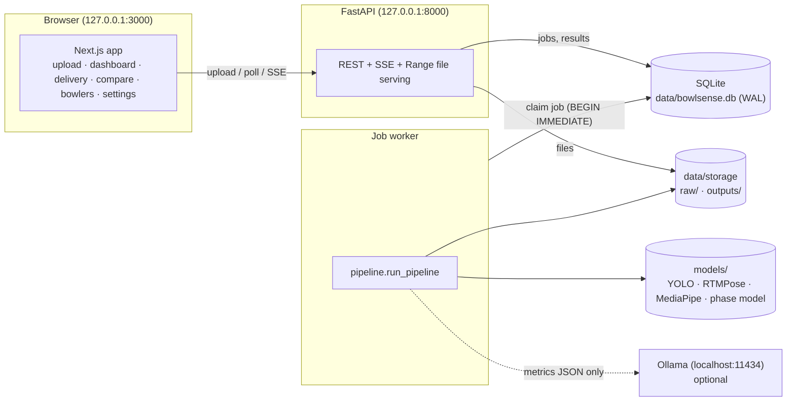
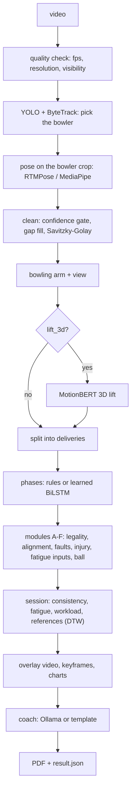

# BowlSense

AI analysis of cricket bowling actions from video, running **100% on your own computer**.

From a video (or a photo) of a bowler, BowlSense produces:
- an annotated skeleton video;
- per-delivery metrics and phase detection;
- elbow-legality screening, technique faults with drills, and an injury-risk screening score;
- ball speed, length and line;
- fatigue and workload trends, and comparison with reference actions;
- a plain-language coaching report and a PDF.

All of it shows up in a local web dashboard.

- **No cloud.** There are no accounts, no hosted APIs and no telemetry. The database is a SQLite file and files stay in `data/`. The AI coach is a local LLM (Ollama).
- **Offline after setup.** Model weights are downloaded once. After that, everything works with the network unplugged, and `BOWLSENSE_OFFLINE=1` blocks every non-localhost connection.
- The API and web app listen on `127.0.0.1` only.

> **Disclaimers.** Legality checks are **2D video screening only**; the official ICC test
> uses 3D motion capture. Injury risk is a **transparent rule-based screening estimate, not a
> trained medical model and not medical advice**. See a qualified professional about pain.

---

## Quick start

```bash
python scripts/setup.py              # one time: Python venv + packages, web app, database
ml/.venv/Scripts/python scripts/download_models.py   # one time: model weights (Linux/macOS: ml/.venv/bin/python)
python run.py                        # starts everything and opens http://127.0.0.1:3000
```

`run.py` does the following:
- migrates the database;
- checks the model files and Ollama;
- starts the API (port 8000), the job worker and the web app (port 3000). If a port is busy, it picks the next free one and says so;
- opens the browser.

Press Ctrl+C to stop everything. Options: `--no-browser`, `--dev` (hot reload), `--offline`.

### Requirements

| | Minimum | Recommended |
|---|---|---|
| RAM | 8 GB | 16 GB |
| GPU | none (CPU works) | NVIDIA GPU with CUDA (pose and detection run several times faster) |
| Software | Python 3.11, Node.js 20+ | [uv](https://docs.astral.sh/uv/) (faster installs) |
| Disk | about 3 GB (packages and models) | plus about 5 GB for the Ollama model |

### Windows

```powershell
py -3.11 scripts\setup.py
ml\.venv\Scripts\python scripts\download_models.py
py run.py
```

### Linux / macOS

```bash
python3.11 scripts/setup.py
ml/.venv/bin/python scripts/download_models.py
python3 run.py
```

With an NVIDIA GPU, `setup.py` detects it (`nvidia-smi`) and installs the CUDA 13 builds from `ml/requirements-gpu.txt`: PyTorch 2.14.1+cu130 and onnxruntime-gpu, about 2.5 GB. Pass `--cpu` to skip them or `--gpu` to force them. YOLO and RTMPose then run on the GPU, which `/health` and the Settings page show. Without a GPU, BowlSense falls back to the CPU with a log line. The GPU can be switched off on the Settings page.

### The AI coach (optional, local)

1. Install Ollama from ollama.com (one-time).
2. Run `ollama pull llama3.1:8b` (about 4.7 GB). On laptops with less RAM, use `qwen2.5:3b` and pick it on the Settings page.

Without Ollama, BowlSense writes a rule-based coaching report from the same numbers and drills. Only the JSON metrics are ever sent to the model, never video or images, and only to `localhost:11434`.

### Running fully offline

After `setup.py` and `download_models.py`, unplug the network. You can also set `BOWLSENSE_OFFLINE=1` (or run `python run.py --offline`): any attempt to connect anywhere except localhost then raises an error. The test suite includes an offline run of the full pipeline and the API.

---

## Recording good footage

- **120 fps or more.** 60 fps is the minimum; release metrics are less reliable below 120.
- **Tripod, side-on** to the crease, about **10 m** away, at about hip height.
- The **whole body in frame** from the run-up to the end of the follow-through.
- Good light and a plain background, with one bowler in view if possible.
- For speed, length and line, the **crease corners must be visible**. Click them once on the session page to calibrate.
- A **front-on** camera adds alignment checks (counter-rotation, mixed action, side-bend, head position).

---

## Using it

- **Web app.** Upload a video and pick or create a bowler. Then watch live progress and read the dashboard: technique score, injury gauge, legality badge, consistency, fatigue trend, pitch map, coach report, PDF and coach chat. Open a delivery for:
  - the overlay video with frame stepping and phase markers;
  - synced angle charts;
  - faults with "jump to frame" and drills;
  - the body risk map.

  **Compare** shows your action against the reference actions side by side. **Bowlers** shows profiles and workload (ACWR). **Settings** covers the coach model, pose backend, GPU, and "delete all my data". Upload a **photo** for single-frame posture checks; you pick which phase the photo shows.
- **Command line** (no web app or database needed):

  ```bash
  cd ml
  .venv/Scripts/python -m bowlsense.cli analyze path/to/video.mp4 --out results/ [--allow-low-fps] [--calib calib.json] [--no-llm] [--backend mediapipe] [--bowling-arm left]
  ```

  This writes `result.json`, `overlay.mp4`, `keyframes/`, `charts/` and `report.pdf`.
- **Evaluation table** (for the course report): `ml/.venv/Scripts/python scripts/evaluate.py`.

---

## Architecture





### Modules

| Module | File | What it does |
|---|---|---|
| Quality | `io/quality.py` | fps (hard limit 60, warning below 120), resolution, visibility, keypoint confidence, camera view |
| Detection | `detect/person.py`, `detect/ball.py` | YOLO11 + ByteTrack bowler selection; ball detection plus a Kalman tracker with gravity |
| Pose | `pose/rtm.py`, `pose/mediapipe_backend.py`, `pose/smoothing.py`, `pose/lift3d.py` | RTMPose-m (ONNX via rtmlib), MediaPipe fallback, cleaning, optional MotionBERT 3D |
| Geometry | `geometry/` | angles, velocities, height in px, bowling arm, mirroring, pitch homography |
| Phases | `phases/heuristic.py`, `phases/model.py` | rule-based events; optional learned BiLSTM (trained on real footage) |
| A Legality | `analysis/legality.py` | elbow extension from arm-horizontal to release vs 15° (screening only) |
| B Alignment | `analysis/alignment.py` | shoulder/hip lines, action type, counter-rotation, hip-shoulder separation |
| C Faults | `analysis/faults.py` | 10 technique faults with severity; technique score |
| D Injury | `analysis/injury.py` | transparent weighted rule model (lumbar, knee, shoulder, side strain, fatigue) |
| E Fatigue | `analysis/fatigue.py` | drift from the baseline deliveries; ACWR workload |
| F Ball | `analysis/delivery.py` | speed, bounce, length and line zones, pitch map (calibration required) |
| G Compare | `analysis/compare.py`, `analysis/bowler_id.py` | DTW similarity to the reference actions, consistency, bowler ID |
| H Coach | `coach/` | drills, local Ollama report and chat, template fallback |
| I Render | `render/` | H.264 overlay (faststart), keyframes, multi-ball clipping, PDF |
| J Image | `image_mode.py` | one photo: front knee, trunk, head, arm slot at the chosen phase |

The reference actions in `data/reference/` are synthetic ("Reference: textbook side-on", and so on). None of them is named after a real player.

---

## Development

```bash
python scripts/setup.py --dev
ml/.venv/Scripts/python scripts/check.py     # or: make check
```

`check.py` runs, in order:
- the local-only URL check;
- ruff, black and mypy (strict);
- pytest with coverage;
- the web checks: ESLint + Prettier, `next build`, Vitest, and a Playwright smoke test (uses the installed Edge on Windows; elsewhere run `npx playwright install chromium` once).

Tests need neither the internet nor real videos: a synthetic skeleton generator (`ml/synth/`) provides ground truth. Put real clips in `ml/tests/data/real/` to run the optional real-video test.

Frontend types are generated from the Python models: `cd web && npm run gen-types`.

Config lives in `config/default.yaml`; local settings-page overrides are in `data/settings.json`.

## Limitations

- 2D video gives approximate joint angles. Out-of-plane motion is foreshortened, and a single camera can't measure everything: the UI marks checks as "needs front view" or "needs side view".
- Legality screening is not an ICC test. Injury risk is a screening heuristic, not a diagnosis.
- Speed, length and line need a crease calibration and a camera that sees the ball's flight. Without them BowlSense reports nothing rather than a guess.
- The learned models were trained on a modest dataset. Pace/spin classification is about 63% accurate on held-out real clips, so treat it as indicative.
- CPU-only pose estimation takes a few minutes for a long clip.
